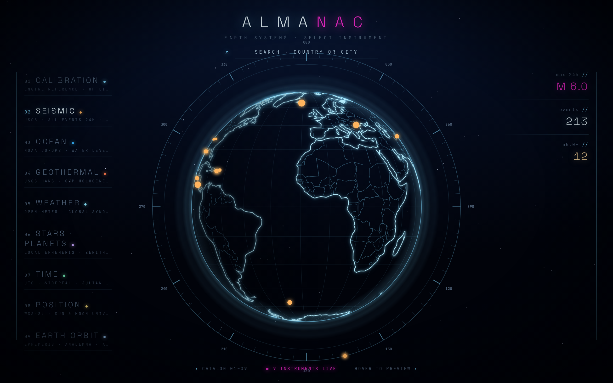

<div align="center">

# 🌍 almanac

### A living globe of Earth's systems — see what the planet is doing right now.

$\textcolor{#7fd9ff}{\textsf{earth}}$ · $\textcolor{#ff2bd6}{\textsf{systems}}$ · $\textcolor{#ffb45e}{\textsf{live}}$

*No accounts, no sign-up, no ads — and your exact location never leaves your device.*

**▶ Open it — [codereimagine.github.io/almanac](https://codereimagine.github.io/almanac/)**

<p>
  
</p>

<sub>Nine instruments — <b>calibration · seismic · ocean · geothermal · weather · sky · time · position · orbit</b> — each with a live feed and an honest offline fallback.</sub>

<sub>By <b>Bert Peters</b> · <a href="https://github.com/codereimagine">codereimagine</a></sub>

</div>

---

## 🛰️ What is it?

almanac is a living globe of Earth's systems. Spin it, pick an instrument, or search any country or city, and it shows you what's happening there $\textcolor{#ffb45e}{\textsf{right now}}$ — earthquakes, ocean tides, weather, the sky overhead. Nine instruments, each reading real public data, and every one has an $\textcolor{#7fd9ff}{\textsf{honest offline fallback}}$, so it never fakes a number.

No app store, no account, nothing to sign up for. Open the link and it works. Like it? Add it to your home screen like any other app.

## ✨ How we do things differently

Most apps want your account, your data, and your attention. Every codereimagine app is built $\textcolor{#ff2bd6}{\textsf{the other way round}}$:

- **Private by default** — no accounts, no tracking, nothing sold. Your exact location stays on *your* device.
- **No ads, no clutter** — nothing on the screen is trying to sell you something.
- **Yours to keep** — installs like an app and keeps working offline, even on a weak signal.
- **Fully open & free** — the whole thing is public (Apache-2.0). Nothing hidden.
- **Made to feel good** — an everyday tool should be beautiful, not just functional.

## 👀 What you can do with it

- **Read Earth live** — earthquakes, ocean tides, weather and the sky, all on one globe.
- **Search any point** — drop a dossier on any country or city.
- **Trust what you see** — every instrument is live or clearly labelled offline; it never pretends.
- **Anywhere** — fast on phones and computers.

## 🛠️ Run or build it yourself (developers)

```bash
git clone https://github.com/codereimagine/almanac.git
cd almanac && npm install
npm run dev        # local dev server
npm run build      # type-check + production build → site/dist
npm run preview    # preview the production build
```

<details><summary><b>🔧 Under the hood</b></summary>

- **Globe:** three.js / react-three-fiber, rendered in the browser.
- **Instruments:** a monorepo design system (`@almanac/engine`) — each instrument is a plugin folder under `site/src/pages`, checked against a real-browser gate battery (its live path *and* its offline path, kept local) before it ships.
- **Data** (keyless, fetched only for the instrument you open): weather — Open-Meteo + MET.no; earthquakes & volcanoes — USGS + Smithsonian GVP; tides & water level — NOAA CO-OPS.
- **City search:** [Open-Meteo geocoding](https://open-meteo.com/en/docs/geocoding-api), keyless — only when you type a country or city.
- **Always-live, offline:** the sky, time, position and orbit instruments are computed on-device with `astronomy-engine` — live even with no network. Geolocation (the position instrument) is used only on-device, never sent.
- **Stack:** React 19 · TypeScript · Vite · three.js / react-three-fiber · `astronomy-engine` · a hand-written service worker (`site/public/sw.js`).

</details>

## 🙌 Credits & thanks

Built with [Claude Code](https://claude.com/claude-code). $\textcolor{#7fd9ff}{\textsf{Nothing here is hidden}}$ — almanac stands on:

- **Data** — [Open-Meteo](https://open-meteo.com) (CC BY 4.0) · [MET Norway](https://www.met.no/en) · USGS · NOAA CO-OPS · Smithsonian Global Volcanism Program.
- **Astronomy** — [`astronomy-engine`](https://github.com/cosinekitty/astronomy) (MIT) by Don Cross.
- **Fonts** — Space Grotesk & JetBrains Mono (SIL Open Font License 1.1).
- **Emoji** — standard Unicode, drawn by your device.

## 📄 License

Apache-2.0 — see [LICENSE](LICENSE).
